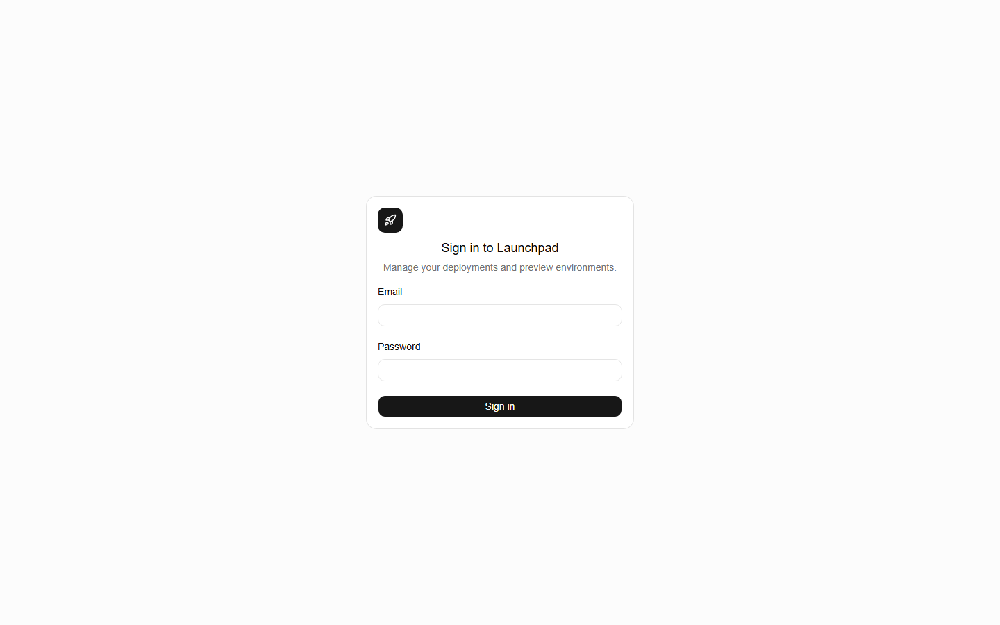
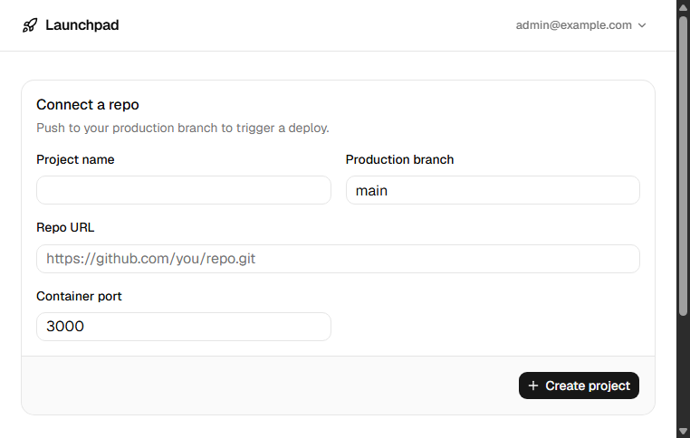
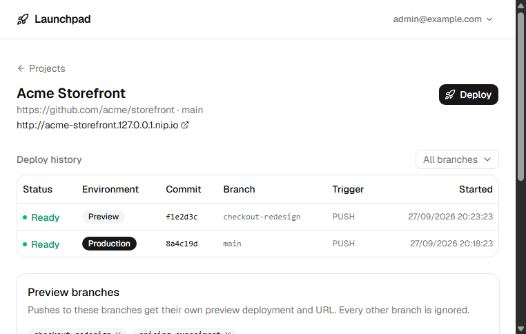
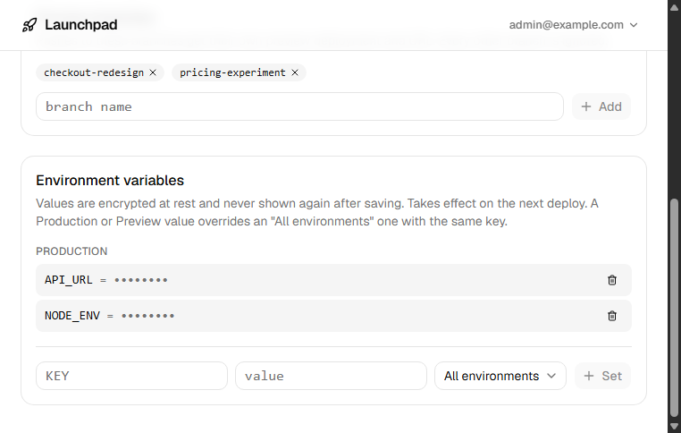
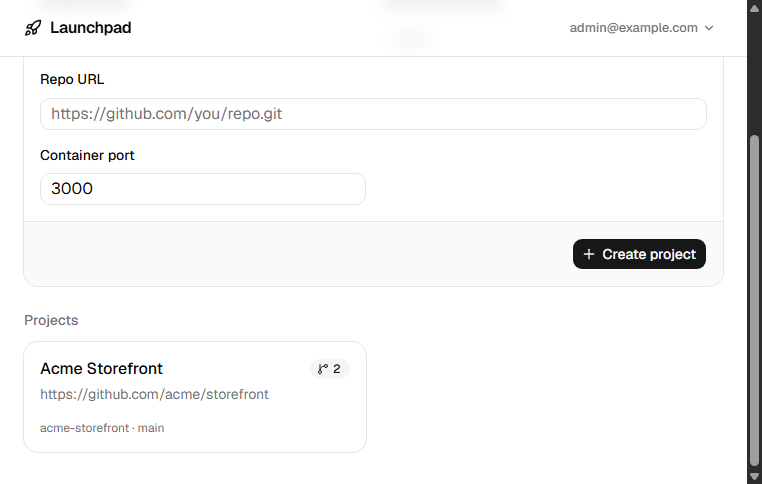
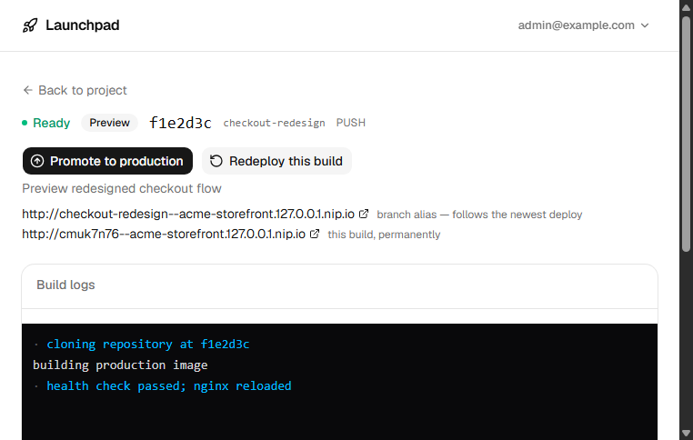
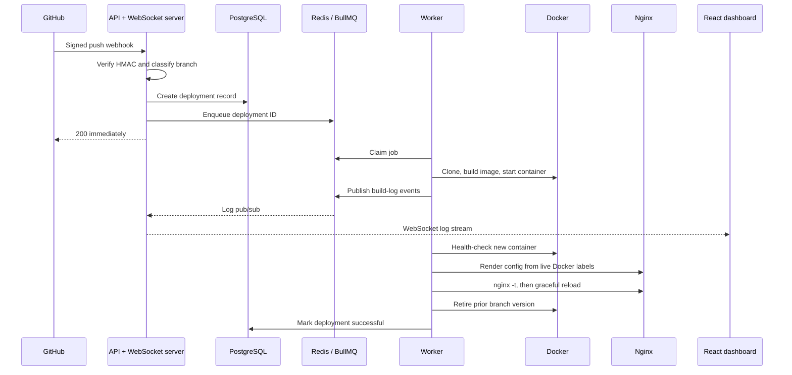

# Launchpad

A self-hosted, local Vercel-style push-to-deploy platform: `git push` triggers a webhook, a queued worker builds a Docker image (from a repo's own `Dockerfile`, or a zero-config detected one), the new container replaces the old one, nginx routes it to a live URL, and a dashboard shows deploy history with live-streaming build logs.

It's a scoped-down rebuild of the push-to-deploy slice of [Openship](https://github.com/oblien/openship), built to demonstrate the mechanics a typical CRUD app doesn't exercise: job queues, the Docker Engine API, reverse-proxy automation, and real-time systems. The full requirements are in [prd-push-to-deploy-platform.md](prd-push-to-deploy-platform.md); day-to-day conventions for working in this repo are in [CLAUDE.md](CLAUDE.md).

## For hiring managers

Launchpad is deliberately designed as a systems-engineering portfolio project rather than a thin deployment UI. It demonstrates how I approach a workflow that crosses HTTP, asynchronous jobs, persistent state, container infrastructure, and real-time clients.

| Engineering area | What this project demonstrates |
| --- | --- |
| Asynchronous systems | Webhook requests are acknowledged quickly and enqueue ID-only BullMQ jobs; a separate worker owns every long-running build and infrastructure mutation. |
| Service boundaries | The API and worker never call each other directly. Redis carries queue work and live-log pub/sub; PostgreSQL is the durable source of truth. |
| Safe deployments | A new container must pass its health check before nginx is regenerated, validated, gracefully reloaded, and only then is the old version retired. A failed deployment leaves the current version untouched. |
| Infrastructure automation | The worker builds images, joins containers to a shared Docker network, renders reverse-proxy configuration from Docker labels, and applies bounded image/container retention. |
| Real-time UX | Build output is persisted for replay and simultaneously published through Redis to a WebSocket fan-out, so the dashboard can show a gapless live log stream. |
| Security fundamentals | GitHub payloads use raw-body HMAC verification; authentication uses httpOnly JWT cookies; repository credentials, webhook secrets, and environment-variable values are AES-256-GCM encrypted at rest. |
| Production thinking | The repository includes local development and production Compose paths, DNS-01 wildcard TLS renewal, health checks, migrations, and an end-to-end deployment script. |

### Dashboard

The dashboard gives the single operator a focused entry point for projects, deployment history, preview environments, and live build logs.

<table>
  <tr>
    <td width="50%"><strong>Authentication</strong><br></td>
    <td width="50%"><strong>Connect a repository</strong><br></td>
  </tr>
  <tr>
    <td width="50%"><strong>Project overview and deploy history</strong><br></td>
    <td width="50%"><strong>Preview branches and environment settings</strong><br></td>
  </tr>
  <tr>
    <td width="50%"><strong>Project list</strong><br></td>
    <td width="50%"><strong>Deployment detail and logs</strong><br></td>
  </tr>
</table>

### How it works



The ordering above is intentional: a deployment becomes live only after its container is healthy and nginx accepts the new configuration. That makes failures contained rather than user-visible outages. Preview branches use the same pipeline but retain a small number of older containers so immutable preview URLs remain available; rollback and promotion reuse an existing image and run the same health/proxy/swap path.

## Demo

1. `git push` to a connected repo's production branch, or to one of its allow-listed preview branches.
2. The dashboard shows the build starting, with logs streaming in real time — clone, framework detection (if no `Dockerfile`), `docker build` output, container start, health check, nginx reload.
3. On success:
   - A push to the **production branch** goes live at `<project>.yourdomain.dev` (or `<project>.127.0.0.1.nip.io` locally).
   - A push to a **preview branch** gets its own stable alias, `<branch>--<project>.yourdomain.dev`, that always follows that branch's latest deploy, plus an immutable `<deploymentId>--<project>.yourdomain.dev` that keeps working even after a newer push to the same branch.
4. Clicking a preview deployment's **Promote to production** points the production URL at it directly — same instant, no-rebuild swap as rollback.
5. Clicking an older deployment's **Rollback** swaps back to its already-built image on its own branch — no rebuild, seconds not minutes.
6. A branch that goes quiet (no push for `STALE_PREVIEW_DAYS`) or gets deleted upstream is torn down automatically by a periodic sweep — its containers stop and its URLs stop resolving, so local Docker doesn't accumulate zombie preview deployments.

## Architecture

Five services share one Docker network, `deploy-net`. Deployed app containers join the **same** network, which is how nginx and the health-check step reach them by container name over Docker's embedded DNS — no host ports are ever published for a deployed app.

```mermaid
flowchart LR
    GH[GitHub webhook] -->|HMAC-verified push| API
    Browser -->|REST + WebSocket| API
    API -->|enqueue job| Redis[(Redis · BullMQ)]
    Redis -->|deploymentId| Worker
    API <-->|projects, deployments, logs| PG[(Postgres)]
    Worker <-->|update status, batch logs| PG
    Worker -->|log lines, pub/sub| Redis
    Redis -->|fan out| API
    Worker -->|Engine API over the socket| Docker[/var/run/docker.sock]
    Docker --> App1[app container]
    Worker -->|render + reload config| Nginx
    Nginx --> App1
    Browser -->|"project.yourdomain.dev"| Nginx
```

**api and worker never call each other directly** — Redis (queue + log pub/sub) and Postgres are the only channels between them. The api enqueues work and serves the dashboard; the worker owns every Docker and nginx mutation. That separation is deliberate, not incidental: it's what makes the build pipeline a real background job system rather than a request handler that happens to take a while.

### Deploy swap

A deploy is only "live" once this sequence completes, in order:

1. **Run** — the new container starts, uniquely named, so the outgoing container keeps serving traffic alongside it.
2. **Health check** — the worker polls the new container directly (over `deploy-net`) until it responds.
3. **nginx** — the project's whole config file is re-rendered from every one of its currently-running containers (not just the new one), validated with `nginx -t`, and reloaded with `nginx -s reload` — restoring the previous config on validation failure, without ever reloading a broken one.
4. **Swap** — *only now* does the previous container get retired, and how depends on environment: a **production** deploy stops its predecessor outright, since only one container may ever answer on the bare project URL; a **preview** deploy instead keeps the newest few containers on that branch alive (see [Preview deployments](#preview-deployments) below), so older immutable URLs keep working.

If step 2 fails, the new container is torn down and nothing else happens — nginx and whatever was previously live are untouched. A bad deploy can never take down what's currently live.

### Preview deployments

Each project has one production branch plus an explicit allow-list of additional branches (`previewBranches`) that are allowed to produce preview deployments — pushing to any other branch is silently ignored, the same as it always was for a single tracked branch. A push to an allow-listed branch gets classified `PREVIEW` and flows through the exact same pipeline as a production deploy; only the branch and environment on the `Deployment` row (and the `launchpad.branch`/`launchpad.environment` container labels derived from them) change what nginx routes to it and what swap.ts retires.

Two things bound how many preview containers can pile up on Docker between deploys: a per-branch cap (`PREVIEW_CONTAINERS_PER_BRANCH`, default 3 — older builds on the same branch get stopped once a newer one arrives) and a periodic staleness sweep (`STALE_PREVIEW_DAYS`, default 1 — a branch with no push in that long, or one GitHub reports deleted, gets fully torn down: containers stopped, nginx's routing for it removed, its `Branch` row marked cleaned-up but kept for history).

### Rollback and promote

Rollback and promote are the same code path, not two — both create a new `Deployment` row that reuses a target deployment's already-built image tag with `skipBuild: true`, then re-enter the identical worker pipeline (`run → health → nginx → swap`) with clone and build skipped. The only difference is which branch/environment the new row carries: rollback stays on the target's own branch (rolling back a preview never touches production), while promote forces the production branch and `PRODUCTION` environment, which is what makes the pipeline give it the bare project URL and the full stop-the-predecessor swap. Same correctness guarantees either way, no duplicated logic, and both are fast because there's nothing to build.

## Tech stack

| Layer | Choice |
| --- | --- |
| API | Node.js, TypeScript, Express, `ws` (shares the API's own `http.Server`) |
| Worker | BullMQ (Redis-backed queue), `dockerode` against the Docker Engine API |
| Data | PostgreSQL + Prisma |
| Reverse proxy | nginx, templated config, `nginx -s reload` per deploy |
| Dashboard | React, Vite, Tailwind, TanStack Query, native WebSocket |
| Orchestration | Docker Compose — `api`, `worker`, `nginx`, `redis`, `postgres` on one shared network |

## Running it locally

Requires Docker with Compose v2+. No GitHub account needed — the E2E path below uses a local git repo.

```bash
git clone <this-repo> && cd launchpad
npm install
cp .env.example .env               # fill in ENCRYPTION_KEY / JWT_SECRET, or let scripts/e2e.sh do it
docker network create deploy-net
docker compose up -d --build
npm run db:migrate
npm run db:seed                    # seeds ADMIN_EMAIL / ADMIN_PASSWORD from .env
npm run dev -w @launchpad/dashboard  # dashboard on http://localhost:5173
```

Then add a webhook pointed at `http://<host>/webhooks/github/<projectId>` (project ID and secret come from the dashboard's "Connect a repo" form) and push. The repo needs a `Dockerfile` at its root, or a `package.json` matching one of the [zero-config patterns](#zero-config-builds) below.

## Production deployment

The default `docker-compose.yml` is intentionally a local development stack: it uses source mounts and watch mode. For a real single-owner deployment, use the separate production composition instead. It has no source mounts or file watchers, builds and serves the dashboard as static assets, and routes the dashboard through nginx on HTTPS.

1. Create a production `.env` outside version control. Generate a unique `JWT_SECRET` and a 32-byte base64 `ENCRYPTION_KEY`; replace the sample admin password. Set `DEPLOY_DOMAIN` (for example, `apps.example.com`), `DASHBOARD_DOMAIN` (for example, `console.apps.example.com`), and `DASHBOARD_ORIGIN=https://console.apps.example.com`.
2. Point both the apex deploy domain and its wildcard DNS record at the host. The dashboard domain must be a subdomain of `DEPLOY_DOMAIN`, because one wildcard certificate covers all deployment and dashboard names.
3. For the included automatic TLS path, create a least-privilege Cloudflare API token with **DNS Edit** for that zone, then set `CERTBOT_EMAIL` and `CLOUDFLARE_DNS_API_TOKEN`. The Certbot service requests `DEPLOY_DOMAIN` plus `*.DEPLOY_DOMAIN` with DNS-01 and renews it every 12 hours; nginx reloads only after a successful renewal.
4. Create the external Docker network once, run `npm run prod:up`, then apply migrations and seed the account:

```bash
docker network create deploy-net
npm run prod:up
npm run db:deploy
npm run db:seed
```

The dashboard is then available at `https://$DASHBOARD_DOMAIN`; GitHub can post to `https://$DASHBOARD_DOMAIN/webhooks/github/<projectId>`. `TLS_ENABLED=true` is the production default. Do not set it to false on an internet-facing host: authentication cookies are secure-only in production.

The Certbot renewal container mounts the Docker socket solely to request nginx reloads after certificate changes. That is host-level access, so protect its environment and treat its Cloudflare token as a secret. Cloudflare is the supported turnkey DNS provider; for another DNS provider, obtain and renew a wildcard certificate externally and mount it using Certbot's `/etc/letsencrypt` layout.

### Prove the whole pipeline without a GitHub account

```bash
npm run e2e
```

`scripts/e2e.sh` spins up the stack, creates a local git commit from `fixtures/sample-app`, registers it as a project, fires a correctly-signed webhook payload at the running API, polls until the deployment succeeds, and curls the project's live `nip.io` URL through nginx to confirm the deployed app actually responds.

### Tests

```bash
npm test
```

Targeted unit tests on the logic worth testing in isolation: GitHub HMAC signature verification, the `AES-256-GCM` encrypt/decrypt round-trip used for every secret at rest, branch classification (production vs. allow-listed preview vs. ignored), zero-config framework detection, multi-target nginx template rendering, image-retention selection, and preview-container capping (never evicts more than the overflow past the keep-N newest). The E2E script above is what actually proves the system works end to end — it now also pushes to a preview branch and promotes it, not just a single production deploy.

## Docker socket security

The worker container mounts `/var/run/docker.sock` so `dockerode` can drive the Docker Engine API directly — build images, start/stop/remove containers, reload nginx via `docker exec`. **Write access to that socket is equivalent to root on the host.** This is the standard, well-known tradeoff for any tool in this category (Coolify, CapRover, Dokku, Portainer, and Openship itself all make the same call) — a container-orchestration platform fundamentally needs to orchestrate containers, and there's no way to do that from inside a container without either this socket mount or a privileged daemon of its own.

Two things are done to keep the blast radius as small as it reasonably can be given that tradeoff:
- **Only the worker gets the socket.** The `api` container — the one directly reachable from GitHub's webhook — never does.
- Everything the worker creates is **labeled** (`launchpad.managed=true`, `launchpad.project=<slug>`), so cleanup and retention never guess based on names and never touch a container or image Launchpad didn't create.

If you're running this somewhere that matters, treat the worker container's compromise as equivalent to host compromise, and scope who can reach it (webhook signature verification, network policy, etc.) accordingly.

## Zero-config builds

A `Dockerfile` at the repo root always wins and behaves exactly as it always has — this is the escape hatch for anything the detector below doesn't recognize. Without one, `apps/worker/src/pipeline/detect.ts` inspects `package.json` and writes a synthetic Dockerfile into the checkout before the normal `docker build` step runs unmodified, so this reuses the entire existing build/run/health/proxy/swap pipeline rather than a parallel one. Tried in order:

1. **Next.js** (`next` in dependencies) — multi-stage build, `next start` on port 3000.
2. **Static sites** (`vite`, `react-scripts`, or `gatsby` in dependencies, plus a `build` script) — build stage produces the static output, served by `nginx:alpine`. Checked before the generic fallback because Create React App also defines a `start` script — one that runs its dev server, not something safe to run in production.
3. **Generic Node** (a `start` script and nothing above matched) — `npm install`/`npm ci` (whichever fits — `ci` only if a lockfile exists), then `npm start`.

Known limits: repo-root only (no monorepos), and no build-time-only environment variables — env vars are injected at container-run time, after the image is already built.
